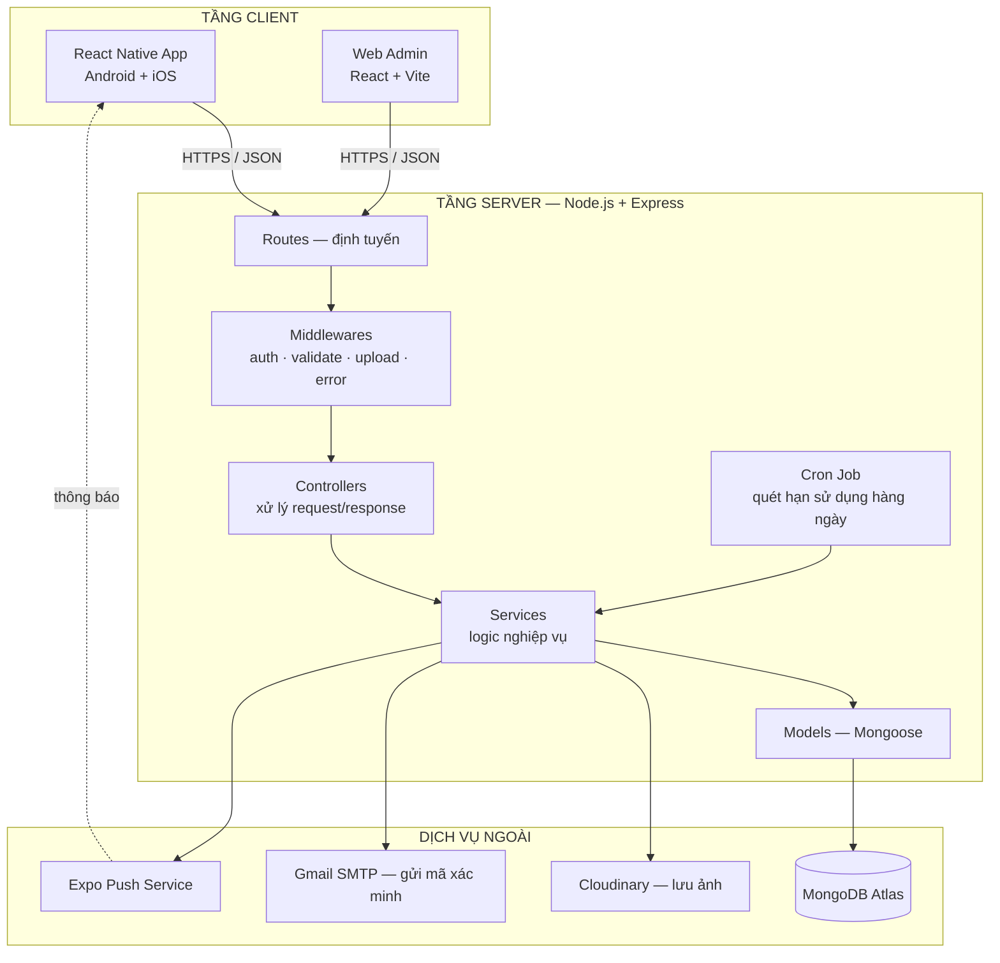
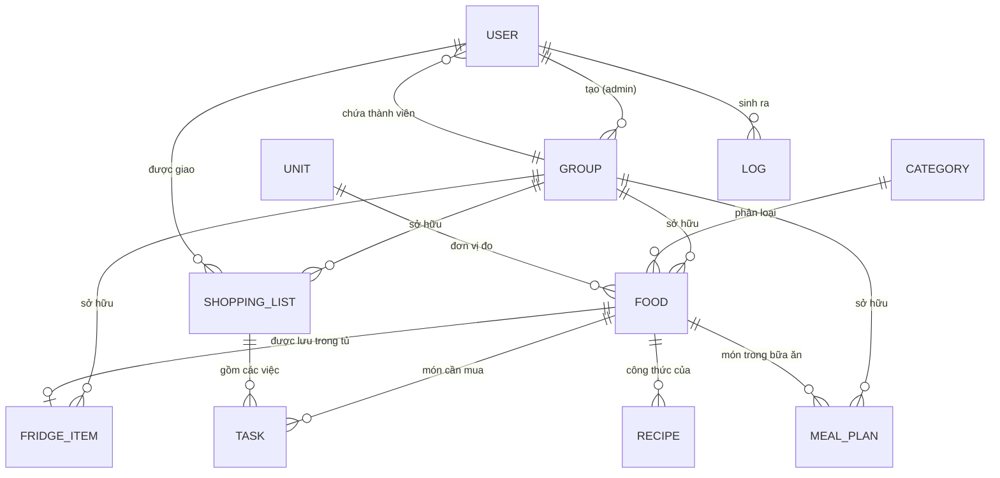
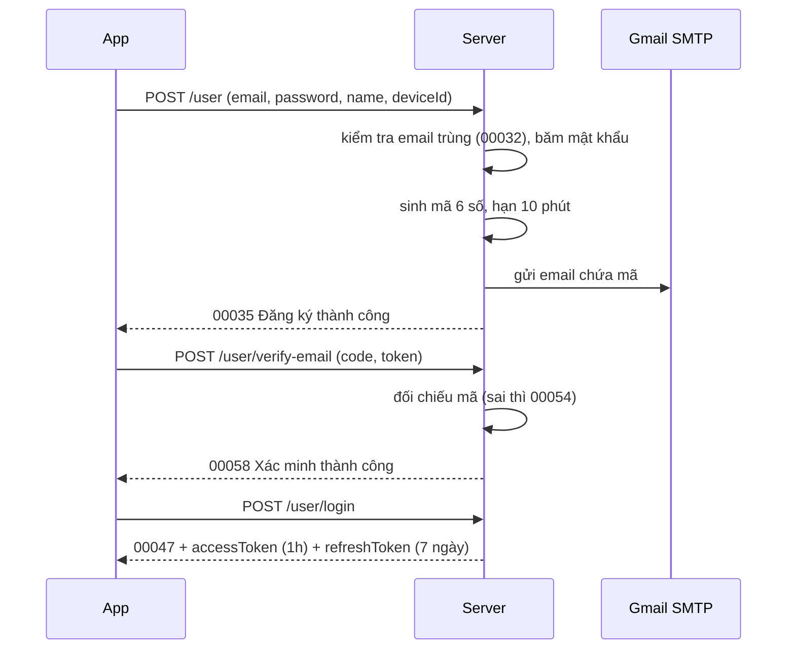
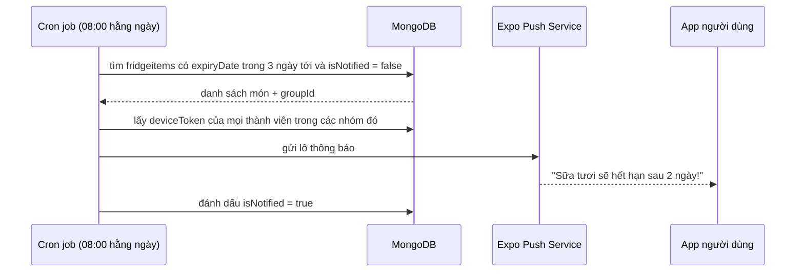

# Kế hoạch & Kiến trúc hệ thống — "Đi chợ tiện lợi"

**Môn học:** IT4788 – Phát triển ứng dụng đa nền tảng
**Tài liệu dành cho:** các thành viên trong nhóm phát triển
**Cập nhật:** 17/09/2026

---

## 0. Công nghệ đã chốt

| Thành phần | Công nghệ | Lý do chọn |
|---|---|---|
| Mobile app | **React Native + Expo**, TypeScript | Máy đã có Node.js nên chạy được ngay, test trực tiếp trên điện thoại qua Expo Go, không cần emulator nặng. Push notification có sẵn qua Expo Notifications |
| Điều hướng | Expo Router (file-based routing) | Cấu trúc rõ ràng, dễ chia việc theo màn hình |
| State / data | Zustand (state cục bộ) + TanStack Query (dữ liệu server) | Nhẹ, ít boilerplate hơn Redux; TanStack Query lo cache, retry, refetch tự động |
| Backend | **Node.js + Express + MongoDB (Mongoose)** | Khớp chính xác đặc tả API của đề (mã `00023` về ObjectId cho thấy đề gốc dùng MongoDB) |
| Database hosting | MongoDB Atlas (gói M0 miễn phí) | Không cần cài Docker/MongoDB local, cả nhóm dùng chung một DB |
| Xác thực | JWT (access token + refresh token) | Đúng với API `Refresh token`, mã lỗi `00011`, `00012`, `00059`–`00065` |
| Lưu trữ ảnh | Cloudinary (gói miễn phí) | Đề có upload ảnh cho `food` và `user`; lưu file trên server sẽ mất khi deploy lại |
| Gửi email | Nodemailer + Gmail App Password | Phục vụ `Send verification code`, `Verify email` |
| Push notification | Expo Push Notification Service | Nhắc thực phẩm sắp hết hạn trước 3 ngày |
| Lập lịch | node-cron | Job chạy hàng ngày quét tủ lạnh tìm đồ sắp hết hạn |
| Trang quản trị | React + Vite + Ant Design (web) | Đề yêu cầu "chức năng quản trị phía admin"; làm web nhanh hơn nhét vào app |
| Deploy backend | Render.com hoặc Railway (miễn phí) | Có HTTPS sẵn, thoả yêu cầu `https://ABC.def/it4788/` |
| Kiểm thử API | Postman | Đề đã cung cấp link Postman mẫu để đối chiếu |

---

## 1. Kiến trúc tổng thể



**Nguyên tắc phân tầng (quan trọng khi chấm điểm kiến trúc):**

- **Controller không được truy cập trực tiếp Model.** Controller chỉ đọc request, gọi service, trả response. Toàn bộ logic nghiệp vụ nằm ở service. Nhờ vậy một service dùng lại được cho cả app lẫn admin, và viết unit test được.
- **Mọi response đều theo một khuôn duy nhất** (mục 3.2) — đây chính là "tính đồng nhất" mà môn học nhấn mạnh.
- **Mọi lỗi đều ném qua lớp `AppError`** và được bắt bởi **một** `errorHandler` ở cuối chuỗi middleware — đây là "tính trong suốt".

---

## 2. Thiết kế cơ sở dữ liệu

### 2.1 Sơ đồ quan hệ



### 2.2 Chi tiết các collection

#### `users` — người dùng

| Trường | Kiểu | Ghi chú |
|---|---|---|
| `_id` | ObjectId | |
| `email` | String | unique, bắt buộc, validate định dạng |
| `password` | String | băm bằng bcrypt, không bao giờ trả về client |
| `name` | String | 3–30 ký tự (mã `00028`) |
| `username` | String | unique, 3–15 ký tự (mã `00081`, `00084`) |
| `avatar` | String | URL Cloudinary |
| `language` | String | `vi` hoặc `en` |
| `timezone` | String | ví dụ `Asia/Ho_Chi_Minh` |
| `deviceToken` | String | Expo push token, dùng để gửi thông báo |
| `isVerified` | Boolean | mặc định `false` |
| `verificationCode` | String | mã 6 số gửi qua email |
| `verificationCodeExpiresAt` | Date | hết hạn sau 10 phút |
| `refreshToken` | String | lưu để thu hồi khi logout |
| `role` | String | `user` hoặc `admin` |
| `groupId` | ObjectId → groups | `null` nếu chưa vào nhóm (mã `00096`) |

#### `groups` — nhóm gia đình

| Trường | Kiểu | Ghi chú |
|---|---|---|
| `name` | String | tên nhóm |
| `adminId` | ObjectId → users | trưởng nhóm, có quyền phân công |
| `members` | [ObjectId → users] | danh sách thành viên |

> **Ràng buộc nghiệp vụ:** một user chỉ thuộc **tối đa một nhóm** — mã `00093`: "Không thể tạo nhóm, bạn đã thuộc về một nhóm rồi".

#### `categories` — danh mục (thịt, rau củ, đồ hộp…)

Do **admin hệ thống** quản lý, dùng chung toàn hệ thống. Trường: `name` (String, unique).

#### `units` — đơn vị đo (kg, gram, quả, hộp…)

Do **admin hệ thống** quản lý. Trường: `name` (String, unique).

#### `foods` — danh mục thực phẩm của nhóm

| Trường | Kiểu | Ghi chú |
|---|---|---|
| `name` | String | unique **trong phạm vi nhóm** (mã `00151`) |
| `categoryId` | ObjectId → categories | |
| `unitId` | ObjectId → units | |
| `image` | String | URL Cloudinary |
| `groupId` | ObjectId → groups | |
| `createdBy` | ObjectId → users | |

#### `fridgeitems` — thực phẩm đang có trong tủ lạnh

| Trường | Kiểu | Ghi chú |
|---|---|---|
| `foodId` | ObjectId → foods | |
| `groupId` | ObjectId → groups | |
| `quantity` | Number | số lượng |
| `expiryDate` | Date | **ngày hết hạn** (đề gọi là `useWithin`) |
| `location` | String | vị trí trong tủ: ngăn mát / ngăn đá / cánh tủ — *đề bài yêu cầu, đặc tả API thiếu* |
| `note` | String | |
| `isNotified` | Boolean | đã gửi thông báo hết hạn chưa, tránh nhắc lặp |

> **Ràng buộc:** mỗi `foodId` chỉ có **một** mục trong tủ của một nhóm (mã `00199`).

#### `shoppinglists` — danh sách đi chợ

| Trường | Kiểu | Ghi chú |
|---|---|---|
| `name` | String | ví dụ "Đi chợ thứ Bảy" |
| `groupId` | ObjectId → groups | |
| `assignedTo` | ObjectId → users | người được trưởng nhóm phân công |
| `note` | String | |
| `date` | Date | ngày dự định đi chợ |
| `createdBy` | ObjectId → users | |

#### `tasks` — từng món trong danh sách đi chợ

| Trường | Kiểu | Ghi chú |
|---|---|---|
| `listId` | ObjectId → shoppinglists | |
| `foodId` | ObjectId → foods | |
| `quantity` | Number | |
| `isCompleted` | Boolean | đã mua xong chưa — *đề bài cần, đặc tả API thiếu* |

> **Ràng buộc:** một món chỉ xuất hiện một lần trong cùng danh sách (mã `00285x`, `00309`).

#### `mealplans` — kế hoạch bữa ăn

| Trường | Kiểu | Ghi chú |
|---|---|---|
| `groupId` | ObjectId → groups | |
| `foodId` | ObjectId → foods | |
| `timestamp` | Date | ngày của bữa ăn |
| `name` | String | `sáng` / `trưa` / `tối` (mã `00316`) |

#### `recipes` — công thức nấu ăn

| Trường | Kiểu | Ghi chú |
|---|---|---|
| `foodId` | ObjectId → foods | công thức gắn với món ăn nào |
| `name` | String | tên công thức |
| `description` | String | mô tả ngắn |
| `htmlContent` | String | nội dung chi tiết dạng HTML, app render bằng `react-native-render-html` |

#### `fridgeevents` — lịch sử mục rời khỏi tủ lạnh (nguồn báo cáo tiêu thụ / lãng phí)

| Trường | Kiểu | Ghi chú |
|---|---|---|
| `groupId` | ObjectId → groups | nhóm sở hữu |
| `foodId` | ObjectId → foods | có thể null nếu thực phẩm đã bị xoá |
| `foodName`, `categoryName`, `unitName` | String | lưu lại tại thời điểm xoá để báo cáo không phụ thuộc dữ liệu hiện tại |
| `quantity` | Number | số lượng tại thời điểm xoá |
| `expiryDate` | Date | hạn sử dụng tại thời điểm xoá |
| `location` | String | vị trí trong tủ |
| `action` | String | `consumed` / `expired` / `discarded` |
| `actedBy` | ObjectId → users | người thực hiện |
| `createdAt` | Date | thời điểm ghi |

#### `logs` — nhật ký hệ thống (phục vụ `Get logs` và mục thống kê)

| Trường | Kiểu |
|---|---|
| `userId` | ObjectId → users (có thể null nếu tài khoản đã bị xoá) |
| `groupId` | ObjectId → groups (có thể null với thao tác quản trị hệ thống) |
| `action` | String — `CREATE` / `UPDATE` / `DELETE` |
| `entity` | String — `user` / `group` / `food` / `fridge` / `shopping` / `task` / `meal` / `recipe` / `category` / `unit` |
| `entityId` | ObjectId |
| `detail` | String — mô tả ngắn, không chứa dữ liệu nhạy cảm |
| `createdAt` | Date |

### 2.3 Index cần tạo (tránh chậm khi dữ liệu nhiều)

```javascript
users:        { email: 1 } unique, { username: 1 } unique
foods:        { groupId: 1, name: 1 } unique
fridgeitems:  { groupId: 1, foodId: 1 } unique, { expiryDate: 1 }
fridgeevents: { groupId: 1, createdAt: -1 }, { groupId: 1, action: 1, createdAt: -1 }
tasks:        { listId: 1, foodId: 1 } unique, { completedAt: 1 }
mealplans:    { groupId: 1, timestamp: 1 }
logs:         { groupId: 1, createdAt: -1 }, { userId: 1, createdAt: -1 },
              { action: 1, entity: 1, createdAt: -1 }, { entity: 1, createdAt: -1 }
```

---

## 3. Thiết kế API

### 3.1 Base URL

```
Development:  http://localhost:5000/it4788/
Production:   https://<ten-mien-cua-nhom>/it4788/
```

### 3.2 Khuôn response thống nhất

Mọi endpoint — thành công hay thất bại — đều trả về đúng cấu trúc này:

```jsonc
// Thành công
{
  "code": "00047",
  "message": "Bạn đã đăng nhập thành công.",
  "data": { }
}

// Thất bại
{
  "code": "00045",
  "message": "Bạn đã nhập một email hoặc mật khẩu không hợp lệ.",
  "data": null
}
```

Toàn bộ 200+ mã của đề được đưa vào **một file duy nhất** `src/constants/responseCode.js`:

```javascript
module.exports = {
  LOGIN_SUCCESS:       { code: '00047', message: 'Bạn đã đăng nhập thành công.' },
  INVALID_CREDENTIALS: { code: '00045', message: 'Bạn đã nhập một email hoặc mật khẩu không hợp lệ.' },
  // ...
};
```

Nhờ vậy không ai phải gõ tay mã lỗi trong controller, và khi đề đổi mã thì chỉ sửa một chỗ.

### 3.3 Bảng ánh xạ nhóm API → chức năng đề bài

| Nhóm | Endpoint chính | Chức năng theo đề |
|---|---|---|
| 1. Auth | `POST /user/login`, `POST /user`, `POST /user/logout`, `POST /user/refresh-token`, `POST /user/send-verification-code`, `POST /user/verify-email` | Đăng nhập, xác thực, phân quyền |
| 2. Tài khoản | `POST /user/change-password`, `PUT /user`, `GET /user`, `DELETE /user` | Cập nhật thông tin tài khoản |
| 3. Nhóm | `POST /user/group`, `POST /user/group/add`, `DELETE /user/group`, `GET /user/group` | Chia sẻ trong nhóm gia đình (B.1) |
| 4. Danh mục | `admin/category` (CRUD) | Phân loại thực phẩm (B.5, B.7) |
| 5. Đơn vị | `admin/unit` (CRUD), `GET /admin/logs` | Đơn vị đo lường, nhật ký (B.7) |
| 6. Thực phẩm | `food/` (CRUD + upload ảnh) | Lưu trữ thông tin thực phẩm (B.3) |
| 7. Tủ lạnh | `fridge/` (CRUD) | Quản lý tủ lạnh, nhắc hết hạn (B.3) |
| 8. Đi chợ | `shopping/`, `shopping/task/` | Danh sách mua sắm, phân công (B.1) |
| 9. Bữa ăn | `meal/` | Lên lịch bữa ăn (B.2) |
| 10. Công thức | `recipe/` | Quản lý công thức nấu ăn (B.4) |
| **11. Bổ sung** | `GET /food/search`, `GET /meal/suggestion`, `GET /report/*`, `PUT /user/device-token` | **Tìm kiếm, gợi ý món, thống kê, push — đề bài yêu cầu nhưng đặc tả API chưa có (xem tài liệu 02)** |

---

## 4. Kiến trúc thư mục backend

```
server/
├── src/
│   ├── config/
│   │   ├── database.js           # kết nối MongoDB Atlas
│   │   ├── cloudinary.js         # cấu hình upload ảnh
│   │   └── env.js                # đọc và kiểm tra biến môi trường
│   ├── constants/
│   │   └── responseCode.js       # TOÀN BỘ mã 00005–00378 của đề
│   ├── models/                   # 12 schema Mongoose (mục 2.2)
│   ├── routes/
│   │   ├── index.js              # gom router, gắn prefix /it4788
│   │   ├── user.route.js
│   │   ├── admin.route.js
│   │   ├── food.route.js
│   │   ├── fridge.route.js
│   │   ├── shopping.route.js
│   │   ├── meal.route.js
│   │   └── recipe.route.js
│   ├── controllers/              # đọc req → gọi service → trả res
│   ├── services/                 # TOÀN BỘ logic nghiệp vụ
│   ├── middlewares/
│   │   ├── auth.middleware.js       # xác thực Bearer token
│   │   ├── admin.middleware.js      # kiểm tra role admin
│   │   ├── groupAdmin.middleware.js # kiểm tra trưởng nhóm
│   │   ├── validate.middleware.js   # kiểm tra đầu vào (Joi)
│   │   ├── upload.middleware.js     # multer + Cloudinary
│   │   └── error.middleware.js      # bắt lỗi tập trung
│   ├── utils/
│   │   ├── AppError.js           # lớp lỗi mang theo mã response
│   │   ├── jwt.js                # ký và xác minh token
│   │   ├── email.js              # gửi mã xác minh
│   │   ├── pushNotification.js   # gửi thông báo qua Expo
│   │   └── logger.js             # ghi vào collection logs
│   ├── jobs/
│   │   └── expiryChecker.job.js  # cron 08:00 mỗi ngày
│   └── app.js
├── .env.example
├── package.json
└── server.js
```

**Luồng một request đi qua hệ thống:**

```
Request
  → route         khớp đường dẫn + method
  → auth          kiểm tra Bearer token, gắn req.user
  → validate      kiểm tra body/param bằng Joi
  → controller    bóc dữ liệu từ req
  → service       logic: kiểm tra quyền, truy vấn DB, tính toán
  → model         Mongoose thao tác MongoDB
  ← response chuẩn hoá
  ⇣ lỗi ở bất kỳ đâu → errorHandler → response chuẩn hoá
```

---

## 5. Kiến trúc mobile app

### 5.1 Cấu trúc thư mục

```
mobile/
├── app/                          # Expo Router — mỗi file là một màn hình
│   ├── (auth)/
│   │   ├── login.tsx
│   │   ├── register.tsx
│   │   ├── verify-email.tsx
│   │   └── forgot-password.tsx
│   ├── (tabs)/                   # 5 tab chính sau khi đăng nhập
│   │   ├── index.tsx             # Trang chủ: tổng quan + cảnh báo hết hạn
│   │   ├── shopping.tsx          # Danh sách đi chợ
│   │   ├── fridge.tsx            # Tủ lạnh
│   │   ├── meal.tsx              # Lịch bữa ăn
│   │   └── profile.tsx           # Cá nhân & nhóm
│   ├── food/[id].tsx
│   ├── recipe/[id].tsx
│   ├── group/manage.tsx
│   └── _layout.tsx               # điều hướng gốc + kiểm tra đăng nhập
├── src/
│   ├── api/
│   │   ├── client.ts             # axios instance + interceptor tự refresh token
│   │   ├── auth.api.ts
│   │   ├── food.api.ts
│   │   └── ...
│   ├── components/               # Button, Input, FoodCard, ExpiryBadge...
│   ├── hooks/                    # useAuth, useFridge, useExpiryAlert...
│   ├── store/                    # Zustand: authStore, groupStore
│   ├── constants/
│   │   └── responseCode.ts       # ánh xạ mã lỗi → thông báo tiếng Việt
│   ├── types/                    # kiểu TypeScript cho toàn bộ model
│   └── utils/
└── app.json
```

### 5.2 Danh sách màn hình (dùng để chia việc)

| # | Màn hình | Chức năng | API sử dụng |
|---|---|---|---|
| 1 | Đăng nhập | email + mật khẩu | `POST /user/login` |
| 2 | Đăng ký | tạo tài khoản | `POST /user` |
| 3 | Xác minh email | nhập mã 6 số | `POST /user/verify-email` |
| 4 | Trang chủ | đồ sắp hết hạn, việc cần mua hôm nay, bữa ăn hôm nay | nhiều API |
| 5 | Tủ lạnh | danh sách + lọc theo danh mục + cảnh báo màu theo hạn | `GET /fridge` |
| 6 | Thêm/sửa đồ tủ lạnh | chọn thực phẩm, số lượng, hạn, vị trí | `POST/PUT /fridge` |
| 7 | Danh sách đi chợ | các list của nhóm, ai được giao | `GET /shopping` |
| 8 | Chi tiết list | các món, tick hoàn thành | `GET/POST /shopping/task` |
| 9 | Tạo list & phân công | trưởng nhóm giao việc | `POST /shopping` |
| 10 | Lịch bữa ăn | xem theo ngày/tuần, 3 bữa | `GET /meal?date=` |
| 11 | Gợi ý món ăn | từ nguyên liệu đang có trong tủ | `GET /meal/suggestion` *(bổ sung)* |
| 12 | Kho thực phẩm | CRUD thực phẩm của nhóm, upload ảnh | `food/` |
| 13 | Công thức nấu ăn | danh sách + chi tiết HTML | `recipe/` |
| 14 | Quản lý nhóm | tạo nhóm, thêm/xoá thành viên | `user/group/` |
| 15 | Hồ sơ cá nhân | sửa tên, ảnh, đổi mật khẩu | `PUT /user` |
| 16 | Thống kê | biểu đồ mua sắm & tiêu thụ | `GET /report/*` *(bổ sung)* |

### 5.3 Xử lý token tự động (điểm cộng kỹ thuật)

`src/api/client.ts` cài một interceptor: khi server trả mã `00011` hoặc `00012` (token hết hạn), client **tự động gọi `refresh-token` rồi phát lại request cũ** — người dùng không hề bị văng ra màn hình đăng nhập. Chỉ khi refresh cũng hỏng (mã `00062`) mới xoá phiên và điều hướng về Login.

---

## 6. Ba luồng nghiệp vụ quan trọng

### 6.1 Đăng ký và xác minh email



### 6.2 Phân quyền ba cấp

| Mức | Ai | Được làm gì |
|---|---|---|
| **Admin hệ thống** | tài khoản `role: admin` | Quản lý `category`, `unit`, xem `logs`, quản lý tài khoản người dùng |
| **Trưởng nhóm** | `group.adminId` | Thêm/xoá thành viên, tạo và phân công danh sách đi chợ, xoá thực phẩm của nhóm |
| **Thành viên** | có `groupId` | Xem và cập nhật dữ liệu của nhóm mình, hoàn thành việc được giao |

Không thuộc nhóm nào thì chỉ dùng được API tài khoản — các mã `00096`, `00185`, `00225`, `00345` đều phục vụ tình huống này.

### 6.3 Nhắc thực phẩm sắp hết hạn



**Lưu ý kỹ thuật:** phải có cờ `isNotified`, nếu không một món sẽ bị nhắc lại mỗi ngày suốt 3 ngày. Khi người dùng sửa `expiryDate`, đặt lại cờ về `false`.

---

## 7. Lộ trình thực hiện — 8 tuần

| Tuần | Mục tiêu | Sản phẩm bàn giao |
|---|---|---|
| **1** | Chuẩn bị & thiết kế | Chốt kiến trúc, dựng repo, tạo MongoDB Atlas, vẽ ERD, thiết kế giao diện trên Figma |
| **2** | Nền móng backend | Kết nối DB, 12 model, file `responseCode`, middleware auth/error, nhóm API Auth chạy được trên Postman |
| **3** | Backend nghiệp vụ 1 | API Nhóm, Danh mục, Đơn vị, Thực phẩm (có upload ảnh Cloudinary) |
| **4** | Backend nghiệp vụ 2 | API Tủ lạnh, Đi chợ, Bữa ăn, Công thức. **Deploy bản đầu lên Render** |
| **5** | App — khung & auth | Dựng Expo, điều hướng, màn hình Đăng nhập/Đăng ký/Xác minh, interceptor refresh token |
| **6** | App — chức năng chính | Màn hình Tủ lạnh, Thực phẩm, Đi chợ, Nhóm |
| **7** | App — phần còn lại + push | Bữa ăn, Công thức, Gợi ý món, Thống kê, Expo Notifications, cron job nhắc hết hạn |
| **8** | Hoàn thiện | Web admin, kiểm thử chéo, sửa lỗi, viết báo cáo, quay video demo, chuẩn bị thuyết trình |

**Mốc quan trọng:** hết tuần 4 backend phải deploy được và test xong bằng Postman. Nếu backend trượt tiến độ, toàn bộ phần app sẽ dồn cục vào hai tuần cuối.

---

## 8. Phân công gợi ý (nhóm 4 người)

| Vai trò | Phụ trách | Khối lượng |
|---|---|---|
| **BE-1 · Trưởng nhóm** | Auth, tài khoản, nhóm, phân quyền, deploy, code review | Nặng nhất, làm sớm nhất |
| **BE-2** | Thực phẩm, tủ lạnh, danh mục, đơn vị, upload ảnh, cron + push | Vừa |
| **FE-1** | Khung app, điều hướng, auth, tủ lạnh, thực phẩm, hồ sơ | Nặng |
| **FE-2** | Đi chợ, bữa ăn, công thức, thống kê, web admin | Nặng |

**Quy ước làm việc chung:**

- Mỗi người làm trên nhánh riêng `feat/<ten-tinh-nang>`, gộp vào `develop` qua Pull Request có người khác review.
- Backend **luôn deploy trước** một nhóm API rồi mới báo FE làm màn hình tương ứng — tránh FE phải chờ hoặc viết dữ liệu giả.
- Mỗi API xong phải **cập nhật Postman collection dùng chung** ngay; coi đó là hợp đồng giữa BE và FE.
- Kiểm thử chéo theo yêu cầu của đề: FE-1 test API của BE-2 và ngược lại, ghi lại vào `docs/test-report.md`.

---

## 9. Checklist đối chiếu yêu cầu đề bài

| Yêu cầu trong đề | Thực hiện ở đâu | Xong |
|---|---|---|
| Danh sách mua sắm hàng ngày | API `shopping/` + màn hình 7, 8, 9 | ☐ |
| Chia sẻ danh sách trong nhóm gia đình | API `user/group/` + `assignedTo` | ☐ |
| Trưởng nhóm phân công việc mua sắm | middleware `groupAdmin` | ☐ |
| Lên lịch bữa ăn (sáng/trưa/tối, theo ngày/tuần) | API `meal/` + màn hình 10 | ☐ |
| **Đề xuất món ăn từ thực phẩm có sẵn** | **API bổ sung `GET /meal/suggestion`** | ☐ |
| Lưu thông tin thực phẩm (tên, số lượng, hạn, **vị trí**) | `fridgeitems` + **trường `location` bổ sung** | ☐ |
| Nhắc nhở trước 3 ngày khi sắp hết hạn | cron job + Expo Push | ☐ |
| Quản lý công thức nấu ăn | API `recipe/` + màn hình 13 | ☐ |
| **Tìm kiếm món ăn / thực phẩm** | **API bổ sung `GET /food/search`** | ☐ |
| Phân loại theo danh mục | `categories` + bộ lọc ở màn hình 5, 12 | ☐ |
| **Thống kê báo cáo mua sắm & tiêu thụ** | **API bổ sung `GET /report/*`** + màn hình 16 | ☐ |
| Quản trị tài khoản & danh mục | Web admin + `admin/` routes | ☐ |
| Xử lý push notification phía client | Expo Notifications trong app | ☐ |
| Kiểm thử tổng hợp, kiểm thử chéo | `docs/test-report.md` | ☐ |

> Các dòng **in đậm** là chức năng đề bài yêu cầu nhưng **đặc tả API không có sẵn** — nhóm tự phát triển thêm. Theo đề, phần này **được tính điểm cộng**. Chi tiết xem `02-GOP-Y-DAC-TA-API.md`.

---

## 10. Bước tiếp theo

1. Đọc và duyệt tài liệu này trong buổi họp nhóm đầu tiên, chốt phân công.
2. Đọc `02-GOP-Y-DAC-TA-API.md` — danh sách lỗi phát hiện trong đặc tả, nộp cho giảng viên để lấy điểm cộng.
3. Tạo MongoDB Atlas cluster và tài khoản Cloudinary (miễn phí, khoảng 10 phút).
4. Khởi tạo hai project `server/` và `mobile/`.
